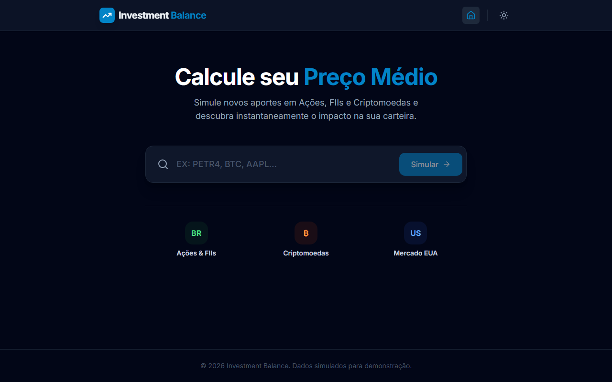

# Investment Balance 📈

**Investment Balance** é um simulador moderno e intuitivo para investidores. Ele permite calcular o novo **Preço Médio** após aportes e verificar o **Preço Teto** (Método Bazin) para ativos geradores de renda.

O aplicativo suporta Ações Brasileiras, Fundos Imobiliários (FIIs), Criptomoedas e Ações Americanas (Stocks).

🔗 **Acesse:** [investment-balance.vercel.app](https://investment-balance.vercel.app/)

<p align="center">
  
  
</p>

---

## 🛠️ Stack Tecnológico

Abaixo estão as principais tecnologias e bibliotecas utilizadas na construção deste projeto:

### Core & Linguagem
*    **React** - Biblioteca para construção da interface.
*    **TypeScript** - Superset JavaScript com tipagem estática.

### Estilização & UI
*    **Tailwind CSS** - Framework CSS utilitário para estilização rápida e responsiva.
*    **Lucide React** - Biblioteca de ícones vetoriais leves.

### Navegação & Roteamento
*    **React Router DOM** - Gerenciamento de rotas e navegação SPA.

### Integrações e APIs Externas
*   🌐 **Fetch API** - Para requisições HTTP nativas.
*   🇧🇷 **BRAPI** - Dados de Ações e FIIs do Brasil.
*   🪙 **CoinGecko** - Dados de Criptomoedas em tempo real.
*   🇺🇸 **Alpha Vantage** - Dados do mercado americano.

### Gerenciamento de Estado & Armazenamento
*   💾 **LocalStorage** - Persistência local do histórico de busca.
*   ⚛️ **React Hooks** - Gerenciamento de estado funcional (`useState`, `useEffect`, `useMemo`).

---

## 🚀 Funcionalidades

1.  **Simulador de Preço Médio:**
    *   Cálculo automático do novo PM após compra.
    *   Visualização de lucro/prejuízo potencial.
    *   Identificação automática do tipo de ativo (BR, EUA, Cripto).

2.  **Calculadora Décio Bazin (Preço Teto):**
    *   Cálculo baseado no Dividend Yield ou valor pago em proventos.
    *   Definição de margem de segurança.
    *   Indicador visual de "Compra Segura" ou "Caro".

3.  **Histórico & Busca:**
    *   Histórico local dos últimos ativos consultados.
    *   Busca inteligente com autocomplete.

## 🏗️ Arquitetura das APIs

| Fonte | Ativos | Onde roda |
|---|---|---|
| **BRAPI** | Ações BR e FIIs | Servidor: função serverless `api/brapi.ts` (Vercel) |
| **CoinGecko** | Criptomoedas | Navegador (API pública, sem chave) |
| **Alpha Vantage** | Ações EUA | Navegador (chave opcional) |

O token da BRAPI **nunca vai para o navegador**: o frontend chama `/api/brapi`, e a função serverless repassa a chamada para a BRAPI com o token lido de `process.env.BRAPI_TOKEN`. Esse proxy:

- **Só aceita o que o app usa:** `quote/list` (busca com `search` e `limit` ≤ 5) e `quote/{TICKER}` (ticker brasileiro válido, com `fundamental` / `modules=defaultKeyStatisticsHistory`). Qualquer outra requisição recebe `400`.
- **Faz cache na CDN da Vercel:** cotações por 5 min e buscas por 1 h. Consultas repetidas não consomem a cota da BRAPI.

Se alguma API falhar ou não estiver configurada, o app usa **dados simulados (Mock)**.

## ⚙️ Configuração (Variáveis de Ambiente)

Todas as chaves são opcionais. Sem elas, o app roda com dados simulados.

| Variável | Onde configurar | Descrição |
|---|---|---|
| `BRAPI_TOKEN` | Vercel → *Settings → Environment Variables* (só no servidor) | Token da [BRAPI](https://brapi.dev). **Não** use o prefixo `VITE_`, senão ele vai parar no bundle público. |
| `VITE_ALPHA_VANTAGE_KEY` | `.env.local` ou Vercel | Chave da [Alpha Vantage](https://www.alphavantage.co). Fica **exposta no navegador**, então use apenas uma chave gratuita. |

### Rodando localmente

```bash
npm install
npm run dev        # frontend apenas (BRAPI cai no Mock)
```

Para testar o proxy da BRAPI localmente, use a [Vercel CLI](https://vercel.com/docs/cli), que executa as funções da pasta `api/`:

```bash
npm i -g vercel
vercel env pull .env.local   # ou crie .env.local com BRAPI_TOKEN=seu_token
vercel dev
```

> Arquivos `.env*.local` já estão no `.gitignore`. Nunca commite tokens.

## 📄 Licença

Distribuído sob a licença [MIT](LICENSE).

---

<div align="center">
  <sub>Desenvolvido para fins educacionais e de simulação.</sub>
</div>