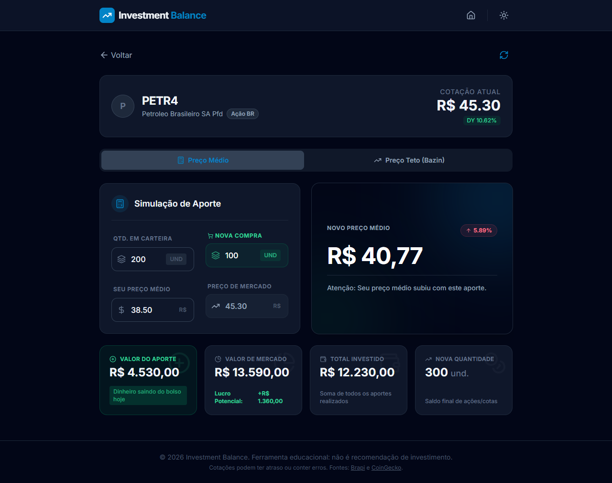
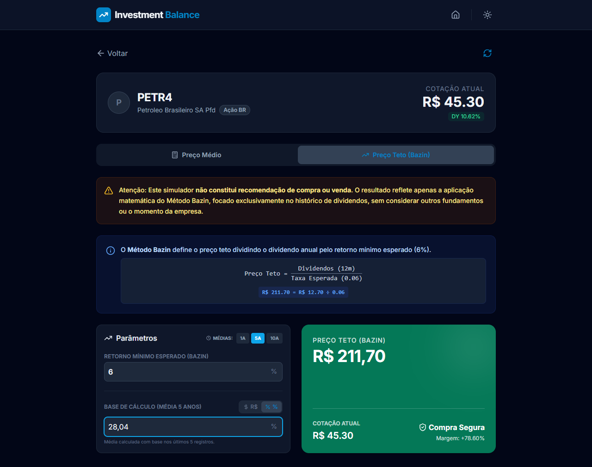

# Investment Balance 📈

**Investment Balance** é um simulador moderno e intuitivo para investidores. Ele permite calcular o novo **Preço Médio** após aportes e verificar o **Preço Teto** (Método Bazin) para ativos geradores de renda.

O aplicativo traz cotações reais de Ações Brasileiras, Fundos Imobiliários (FIIs) e Criptomoedas. Ações Americanas estão disponíveis apenas como demonstração (AAPL, TSLA, NVDA).

🔗 **Acesse:** [investment-balance.vercel.app/app/](https://investment-balance.vercel.app/app/)

<p align="center">
  
</p>

<table>
  <tr>
    <td width="50%" align="center"></td>
    <td width="50%" align="center"></td>
  </tr>
  <tr>
    <td align="center"><sub><b>Simulador de Preço Médio</b></sub></td>
    <td align="center"><sub><b>Preço Teto (Método Bazin)</b></sub></td>
  </tr>
</table>

---

## 🛠️ Stack Tecnológico

Abaixo estão as principais tecnologias e bibliotecas utilizadas na construção deste projeto:

### Core & Linguagem
*    **React** - Biblioteca para construção da interface.
*    **TypeScript** - Superset JavaScript com tipagem estática.

### Estilização & UI
*    **Tailwind CSS** - Framework CSS utilitário para estilização rápida e responsiva.
*    **Lucide React** - Biblioteca de ícones vetoriais leves.

### Navegação & Roteamento
*    **React Router DOM** - Gerenciamento de rotas e navegação SPA.

### Integrações e APIs Externas
*   🌐 **Fetch API** - Para requisições HTTP nativas.
*   🇧🇷 **BRAPI** - Dados de Ações e FIIs do Brasil.
*   🪙 **CoinGecko** - Dados de Criptomoedas em tempo real.

### Gerenciamento de Estado & Armazenamento
*   💾 **LocalStorage** - Persistência local do histórico de busca.
*   ⚛️ **React Hooks** - Gerenciamento de estado funcional (`useState`, `useEffect`, `useMemo`).

---

## 🚀 Funcionalidades

1.  **Simulador de Preço Médio:**
    *   Cálculo automático do novo PM após compra.
    *   Visualização de lucro/prejuízo potencial.
    *   Identificação automática do tipo de ativo (BR, EUA, Cripto).

2.  **Calculadora Décio Bazin (Preço Teto):**
    *   Cálculo baseado no Dividend Yield ou valor pago em proventos.
    *   Definição de margem de segurança.
    *   Indicador visual de "Abaixo" ou "Acima" do preço teto.
    *   Médias de DY de 1, 5 e 10 anos a partir do histórico da BRAPI.

3.  **Histórico & Busca:**
    *   Histórico local dos últimos ativos consultados.
    *   Busca com autocomplete (com debounce, para economizar chamadas à API).

## 🏗️ Arquitetura das APIs

| Fonte | Ativos | Onde roda |
|---|---|---|
| **BRAPI** | Ações BR e FIIs | Servidor: função serverless `api/brapi.ts` (Vercel) |
| **CoinGecko** | Criptomoedas | Navegador (API pública, sem chave) |
| — | Ações EUA | Apenas dados de demonstração |

O token da BRAPI **nunca vai para o navegador**: o frontend chama `/api/brapi`, e a função serverless repassa a chamada para a BRAPI com o token lido de `process.env.BRAPI_TOKEN`. Esse proxy:

- **Só aceita o que o app usa:** `quote/list` (busca com `search` e `limit` ≤ 5) e `quote/{TICKER}` (ticker brasileiro válido, com `fundamental` / `modules=defaultKeyStatisticsHistory`). Qualquer outra requisição recebe `400`.
- **Faz cache na CDN da Vercel:** cotações por 5 min e buscas por 1 h. Consultas repetidas não consomem a cota da BRAPI.

### Headers de segurança

O `vercel.json` aplica a todas as respostas uma **Content-Security-Policy** restrita: só scripts do próprio domínio, conexões apenas com `/api` e com a CoinGecko, e fontes do Google Fonts. Também aplica `X-Frame-Options: DENY`, `X-Content-Type-Options: nosniff`, `Referrer-Policy` e `Permissions-Policy`. Ao adicionar uma nova API externa chamada pelo navegador, inclua o domínio em `connect-src`.

### Dados de demonstração

Se a fonte real não responder (ou o `BRAPI_TOKEN` não estiver configurado), o app usa um pequeno conjunto de **dados de demonstração** e mostra um aviso claro na tela. Para tickers fora desse conjunto, o app informa que o ativo não foi encontrado — ele **nunca inventa preços**.

## ⚙️ Configuração (Variáveis de Ambiente)

A única variável é opcional: sem ela, ações BR e FIIs usam os dados de demonstração. Veja também o [`.env.example`](.env.example).

| Variável | Onde configurar | Descrição |
|---|---|---|
| `BRAPI_TOKEN` | Vercel → *Settings → Environment Variables* (só no servidor) | Token da [BRAPI](https://brapi.dev). **Não** use o prefixo `VITE_`, senão ele vai parar no bundle público. |

### Proteção opcional por senha

O arquivo [`middleware.ts`](middleware.ts) permite colocar **o app** (`/app/*`, incluindo JS/CSS) e a API (`/api/*`) atrás de usuário e senha (HTTP Basic Auth). A landing page na raiz (`/`) continua pública, sem banco e sem serviço externo. Ele fica **desligado por padrão** e só é ativado quando as **duas** variáveis abaixo existem na Vercel:

| Variável | Descrição |
|---|---|
| `BASIC_AUTH_USER` | Usuário exigido no login |
| `BASIC_AUTH_PASSWORD` | Senha exigida no login |

Para desligar, remova as variáveis e faça um novo deploy. O arquivo não depende de nada do projeto, então pode ser copiado para qualquer outro app na Vercel.

### Estrutura do deploy

Um único projeto na Vercel serve tudo:

| Caminho | Conteúdo | Origem |
|---|---|---|
| `/` | Landing page (pública) | arquivos estáticos de `landing/`, copiados por `scripts/build-landing.mjs` |
| `/app/` | O app (React) | build do Vite (`base: '/app/'`, saída em `dist/app/`) |
| `/api/*` | Funções serverless | pasta `api/` |

O app usa rotas com `#` (ex.: `/app/#/simulate/PETR4`). Links antigos sem `/app/` são redirecionados pela landing.

### Rodando localmente

```bash
npm install
npm run dev        # http://localhost:3000/app/ — frontend apenas (BRAPI usa dados de demonstração)
```

Para testar o proxy da BRAPI localmente, use a [Vercel CLI](https://vercel.com/docs/cli), que executa as funções da pasta `api/`:

```bash
npm i -g vercel
vercel env pull .env.local   # ou crie .env.local com BRAPI_TOKEN=seu_token
vercel dev
```

> Arquivos `.env*.local` já estão no `.gitignore`. Nunca commite tokens.

## 🪧 Landing page

A pasta [`landing/`](landing/) contém uma landing page estática de apresentação do projeto (HTML + CSS puros, sem build, sem dependências npm e sem JavaScript). Ela é independente do app: não usa nada de fora da própria pasta, e as capturas de tela ficam em `landing/assets/`.

Para publicar na Vercel como um **segundo projeto**, importe este mesmo repositório e configure:

| Configuração | Valor |
|---|---|
| Root Directory | `landing` |
| Framework Preset | Other |
| Build Command | vazio (sem build) |
| Output Directory | vazio (padrão: a própria pasta) |

Os headers de segurança (CSP restrita, `X-Frame-Options`, `nosniff` etc.) da landing ficam em `landing/vercel.json`. O `vercel.json` da raiz e a função `api/` pertencem apenas ao app e **não** fazem parte da landing.

Para ver localmente, sirva a pasta com qualquer servidor estático, por exemplo `npx serve landing`.

## 📄 Licença

Distribuído sob a licença [MIT](LICENSE).

---

<div align="center">
  <sub>Desenvolvido para fins educacionais e de simulação. Não é recomendação de investimento.</sub>
</div>